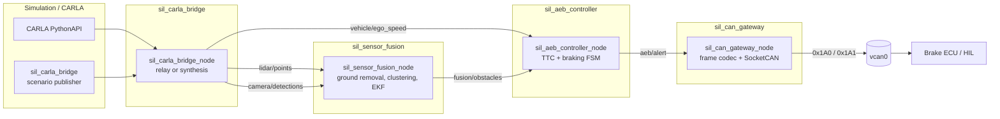
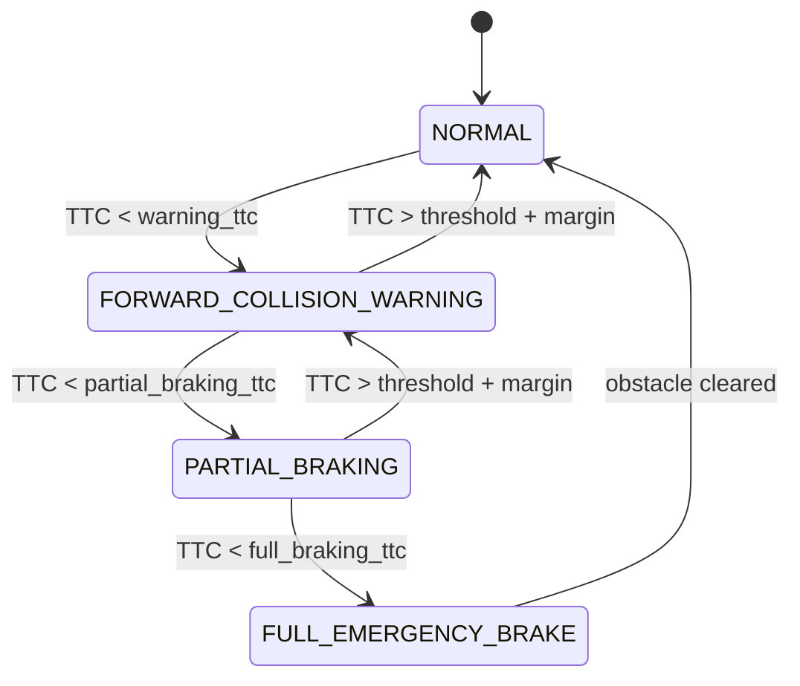

# SIL Autonomous Emergency Braking (AEB)

A Software-in-the-Loop autonomous driving stack that turns 3D LiDAR and camera
input into a braking command on a virtual CAN bus. It is built as a ROS 2 Humble
workspace in C++17 and integrates with the CARLA simulator through a bridge node.

The pipeline is:

```
CARLA / synthetic actors -> LiDAR + camera -> EKF sensor fusion
      -> TTC + braking FSM -> SocketCAN frames on vcan0
```

Every stage runs without a simulator or a physical bus, which is what makes the
system testable in CI. A synthetic CARLA actor publisher stands in for the
simulator, and the CAN gateway has a dry-run mode for hosts without `vcan0`.

## Contents

- [Architecture](#architecture)
- [Packages](#packages)
- [Quick start](#quick-start)
- [Running the stack](#running-the-stack)
- [CAN protocol](#can-protocol)
- [Testing](#testing)
- [CI](#ci)
- [Repository layout](#repository-layout)

## Architecture

The nodes communicate over four topics. The CARLA bridge owns the sensor
boundary, the fusion node owns the world model, the controller owns the
decision, and the gateway owns the actuator.



### Sensor fusion

The fusion node removes the ground plane, clusters the remaining points, and
feeds range/bearing observations into a per-track Extended Kalman Filter. The
state vector is

```
X = [x, y, vx, vy]^T
```

with a constant-velocity process model. The measurement is polar, so the
innovation is computed in range/bearing space and gated by a chi-square distance
(9.2103 for 2 degrees of freedom at 99%) before the update. Camera detections
contribute bearings for tracks the LiDAR already sees, which is what sets the
`multimodal` flag on a published obstacle.

The cycle budget is 18 ms. `test_fusion_latency` measures the fusion step and
fails if it exceeds the budget, so a regression in the EKF or the clusterer is
caught by the test suite rather than at runtime.

### Braking FSM

The controller computes Time-To-Collision as `TTC = distance / relative_velocity`
and drives a four-state machine:



Escalation is immediate, because a braking system must fail safe rather than
fail slow. De-escalation is rate limited by `release_ttc_margin` and
`min_state_duration`, which stops the state oscillating when the TTC sits on a
threshold.

The FSM is a pure function of its input, with no ROS types, so it is unit tested
directly and can be driven by a service call (`aeb/set_state`) from a HIL bench.

## Packages

| Package | Purpose | Key components |
| --- | --- | --- |
| `sil_interfaces` | Custom message and service definitions | `Obstacle`, `ObstacleArray`, `SafetyAlert`, `Detection2D`, `Detection2DArray`, `CarlaActor`, `CarlaActorArray`, `SetAebState` |
| `sil_carla_bridge` | CARLA ingestion and sensor synthesis | `CarlaBridgeNode`, `LidarSynthesizer`, `FrameTransform`, `ScenarioPublisher` |
| `sil_sensor_fusion` | Ground removal, clustering, EKF tracking | `LidarClusterer`, `ClusterGeometry`, `EkfTracker`, `MultiTargetTracker`, `CameraProjection` |
| `sil_aeb_controller` | TTC computation and the braking FSM | `TtcCalculator`, `TargetSelector`, `AebFsm` |
| `sil_can_gateway` | Frame serialization and SocketCAN transport | `CanFrameCodec`, `SocketCanTransport`, `CanGatewayNode` |
| `sil_bringup` | Top-level launch files | `sil_aeb_stack.launch.py` |

Each package separates its numerical core from its ROS wrapper. The core is a
plain static library with no ROS dependency, so it can be built and tested on any
host; the node library links the core and adds the ROS plumbing.

## Quick start

Ubuntu 22.04 (Jammy) is the target platform, since that is what ROS 2 Humble
ships for.

```bash
# 1. Install dependencies (add --core for the ROS-free build only).
./scripts/install_dependencies.sh

# 2. Build and run the fast core tests.
./scripts/run_tests.sh

# 3. Build the ROS 2 workspace and run the full test suite.
source /opt/ros/humble/setup.bash
./scripts/run_tests.sh --ros

# 4. Create the virtual CAN interface.
./scripts/setup_vcan.sh
```

The core build needs only CMake, Eigen3, PCL, and GoogleTest. The ROS build adds
`ros-humble-desktop`, `pcl_conversions`, and the ament tooling.

## Running the stack

The default launch is fully synthetic: no CARLA process and no CAN bus are
required.

```bash
source install/setup.bash
ros2 launch sil_bringup sil_aeb_stack.launch.py publish_scenario:=true
```

With a synthetic scenario running, the stack drives itself into an emergency
brake. Watch the decision on the alert topic:

```bash
ros2 topic echo /aeb/alert
```

With a real CARLA instance:

```bash
ros2 launch sil_bringup sil_aeb_stack.launch.py use_carla:=true
```

With a live CAN bus instead of dry-run:

```bash
ros2 launch sil_bringup sil_aeb_stack.launch.py dry_run:=false
# in another shell
candump vcan0
```

Available synthetic scenarios are `lead_vehicle_braking` (the default),
`lead_vehicle_constant`, `static_obstacle`, and `pedestrian_crossing`:

```bash
ros2 launch sil_bringup sil_aeb_stack.launch.py \
  publish_scenario:=true scenario:=pedestrian_crossing
```

### Services

`aeb/set_state` (`sil_interfaces/srv/SetAebState`) forces or releases the FSM,
which is how a test harness or HIL bench takes over:

```bash
ros2 service call /aeb/set_state sil_interfaces/srv/SetAebState \
  "{state: 3, latch: true}"    # latch a full emergency brake
ros2 service call /aeb/set_state sil_interfaces/srv/SetAebState \
  "{state: 0, latch: false}"   # release it
```

## CAN protocol

Two classic 8-byte frames carry the brake interface.

### `0x1A0` brake command

| Byte | Signal | Encoding |
| --- | --- | --- |
| 0..1 | Requested deceleration | `uint16` little endian, 0.001 m/s² per count |
| 2 | Brake pressure | `uint8`, 0.4% per count, saturating at 250 |
| 3 | Status | bits [1:0] FSM state, bit 2 `state_changed`, bit 3 override, bit 4 valid |
| 4..5 | Target track id | `uint16` little endian |
| 6 | Rolling counter | high nibble |
| 7 | CRC-8/SAE-J1850 | over bytes 0..6 |

### `0x1A1` target speed

| Byte | Signal | Encoding |
| --- | --- | --- |
| 0..1 | Target speed | `int16` little endian, 0.001 m/s per count |
| 2..3 | Ego speed | `int16` little endian, same scaling |
| 4 | Deceleration request | `uint8`, 0.01 m/s² per count |
| 5 | Brake pressure | `uint8`, same scaling as above |
| 6 | Rolling counter | high nibble |
| 7 | CRC-8/SAE-J1850 | over bytes 0..6 |

Both frames are validated on decode: the identifier, the DLC, and the CRC must
all match, and deceleration is saturated rather than wrapped. A command that
fails validation is dropped rather than acted on.

## Testing

Every package has GoogleTest coverage, split between pure-math suites and
node-level suites.

| Suite | What it covers |
| --- | --- |
| `test_ekf_tracker` | Predict/update matrices, covariance growth, gating, angle wrapping |
| `test_multi_target_tracker` | Track lifecycle: tentative, confirmed, coast, deletion |
| `test_cluster_geometry` | Ground plane fitting, bounding boxes, centroid geometry |
| `test_lidar_clusterer` | Euclidean clustering, ROI and height filters |
| `test_camera_projection` | Pinhole projection, bearing/range conversion |
| `test_fusion_latency` | The 18 ms cycle budget |
| `test_ttc_calculator` | TTC, time-to-impact with braking, no-collision cases |
| `test_target_selector` | Threat ranking, lane and range gates |
| `test_aeb_fsm` | Every state transition, hysteresis, override, reset |
| `test_aeb_scenario` | End-to-end scenario replays through the FSM |
| `test_can_frame_codec` | Bit packing, round trips, CRC, saturation |
| `test_crc8` | CRC-8/SAE-J1850 known-answer vectors |
| `test_scaling` | Fixed-point scaling and saturation limits |
| `test_frame_transform` | CARLA left-handed to REP-103 conversion |
| `test_lidar_synthesizer` | Ray casting, ring/azimuth layout, noise |
| `test_sensor_fusion_node` | Node construction, parameters, sweep to track |
| `test_aeb_controller_node` | Timer rate, escalation, stale-track release, service |
| `test_can_gateway_node` | Encoding on the wire, dry-run, stale-alert fallback |
| `test_carla_bridge_node` | Synthesis vs relay mode, counters, published messages |
| `test_socketcan_transport` | Failure paths without a CAN interface |

```bash
# ROS-free core suites (fast).
ctest --test-dir build --output-on-failure

# Full ROS 2 suite.
colcon test --event-handlers console_direct+
colcon test-result --all --verbose
```

## CI

`.github/workflows/ci.yml` runs three jobs:

- **core-tests** builds the ROS-free core on `ubuntu-22.04` and runs every
  GoogleTest suite. No ROS installation, so it is the fast feedback loop.
- **ros-humble** builds the workspace inside the official `ros:humble-ros-base`
  image with `colcon build` and runs `colcon test`, validating the package
  layout and the node tests against the real Humble release.
- **lint** runs `cpplint` against the Google C++ Style Guide.

## Repository layout

```
.
├── CMakeLists.txt              # ROS-free core build (colcon ignores this file)
├── cmake/core_tests.cmake      # Core libraries and GoogleTest targets
├── .github/workflows/ci.yml    # CI pipeline
├── scripts/
│   ├── install_dependencies.sh # Apt dependencies, ROS 2 Humble included
│   ├── setup_vcan.sh           # Creates and brings up vcan0
│   └── run_tests.sh            # Core or ROS test runner
└── src/
    ├── sil_interfaces/         # msg and srv definitions
    ├── sil_carla_bridge/       # CARLA ingestion and sensor synthesis
    ├── sil_sensor_fusion/      # Clustering and EKF tracking
    ├── sil_aeb_controller/     # TTC and the braking FSM
    ├── sil_can_gateway/        # CAN codec and SocketCAN transport
    └── sil_bringup/            # Top-level launch files
```

Each package follows the same layout: `include/<pkg>/` for headers, `src/` for
implementations, `test/` for GoogleTest suites, and `config/` plus `launch/` for
runtime configuration.

## Design notes

A few decisions are worth calling out because they are not obvious from the code.

**Core libraries are ROS-free.** The EKF, the FSM, and the CAN codec do not
include any ROS header. This keeps them unit testable without a ROS graph, and it
is why the CI core job needs no ROS installation.

**Failures degrade instead of crashing.** The CAN gateway logs an error and
continues in dry-run mode when the interface cannot be opened, and both the
controller and the gateway drop stale input rather than latching the last
command. A missing sensor or a dead peer must never hold the brakes on.

**Escalation is immediate, release is damped.** AEB is a safety function, so it
must react on the cycle the threat appears. Releasing too eagerly would produce
brake chatter, so de-escalation waits for both a TTC margin and a minimum state
duration.

## License

Apache-2.0. See the SPDX headers in each source file.
